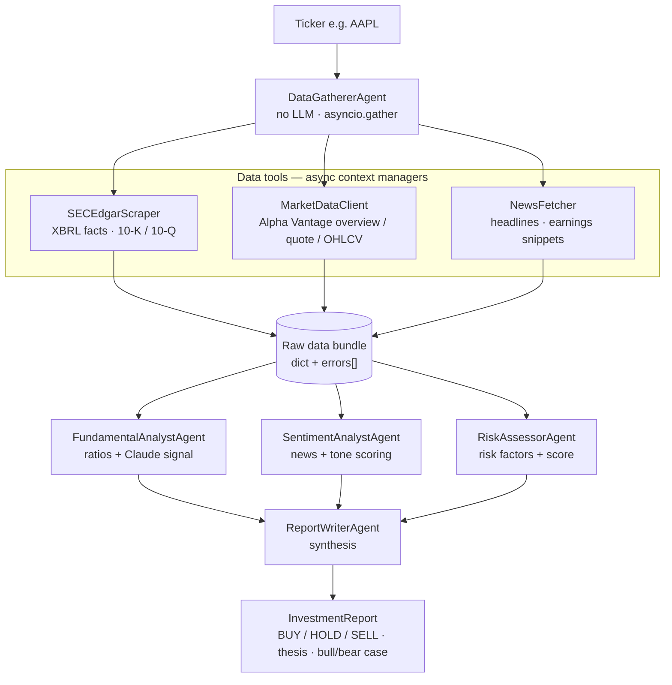

<p align="center"></p>

# finance-agent-crew

[](https://github.com/shaikn6/finance-agent-crew/actions/workflows/ci.yml)
[](LICENSE)
[](pyproject.toml)

**A multi-agent crew that turns a stock ticker into a structured, sourced equity research brief: concurrent data collection (SEC EDGAR, Alpha Vantage, news), three specialist analyst agents running in parallel, and a report writer that synthesizes a BUY / HOLD / SELL signal.**

Live mode calls Claude and the public data sources; offline mode swaps every LLM call and data tool for in-repo fixtures, so the whole pipeline and its HTTP API run with no keys and no network. The [Quickstart](#quickstart) returns a full report in one `curl`. The suite has 333 tests at 99% line coverage, and no test calls a real LLM or external service.

The signal is the output of a research pipeline, not investment advice: it has not been evaluated against later market returns.

## Why this exists

Most multi-agent demos are a chain of free-text prompts that fails as soon as one model reply is malformed. This crew is built the other way round: data gathering is plain concurrent I/O with no LLM, each analyst makes one bounded call that must return strict JSON into a Pydantic model, and any failed or malformed call degrades to a neutral default instead of ending the run. It shows how to keep an agent pipeline typed, testable and cheap (one Haiku call per analyst).

## Architecture

The crew is a deterministic fan-out / fan-in pipeline. `DataGathererAgent` is intentionally LLM-free and I/O-bound: it runs the three data tools concurrently with `asyncio.gather` and returns one structured bundle. That bundle feeds three independent analyst agents (each makes a single structured Claude call), and `ReportWriterAgent` fans the three analyses back in to a final `InvestmentReport`. Every external call is non-fatal — failures are captured in an `errors` list rather than aborting the run.



## Agents

| Agent | Role | Inputs / method |
|-------|------|-----------------|
| `DataGathererAgent` | Concurrent data collection, no LLM | Runs SEC / market / news fetches via `asyncio.gather`; non-fatal error collection |
| `FundamentalAnalystAgent` | Valuation, profitability, leverage | Computes P/E, P/B, ROE, gross/operating/net margins, debt-to-equity, **3-yr revenue CAGR derived from real period-end date spans**, then asks Claude for a `Signal` |
| `SentimentAnalystAgent` | News + management tone | Aggregates ≤15 headlines and earnings snippets into one Claude call → tone, `[-1, +1]` sentiment score, themes, bullish/bearish signals |
| `RiskAssessorAgent` | Risk factor identification | Claude scores named risk factors (LOW/MEDIUM/HIGH) + overall `risk_score` |
| `ReportWriterAgent` | Final synthesis | Fans the three analyses into an `InvestmentReport` with executive summary, thesis, and bull/bear cases |

## Data tools

| Tool | Source | Notes |
|------|--------|-------|
| `SECEdgarScraper` | SEC EDGAR | XBRL financial facts + recent 10-K / 10-Q filings; async context manager |
| `MarketDataClient` | Alpha Vantage | Company overview, real-time quote, 12-month monthly OHLCV |
| `NewsFetcher` | DuckDuckGo search + RSS (Yahoo Finance, Seeking Alpha) | Recent headlines + earnings-call snippets |

## How it works

- **Structured-output discipline.** Every analyst prompts Claude for strict JSON and parses it through a code-fence-tolerant decoder. A parse failure, an out-of-contract field, or a failed LLM call (API error, timeout, dropped connection) degrades to `INSUFFICIENT_DATA` / neutral defaults rather than crashing — no analyst can take down a run. All four LLM-backed agents go through one call boundary (`src/llm.py`) that turns any failure into a single `LLMError`.
- **Real CAGR, not list arithmetic.** `_cagr()` sorts SEC revenue history by `period_end`, then derives the exponent from the *actual* elapsed days between the oldest and newest filing (`(latest/oldest) ** (1/actual_years) - 1`), so the growth rate reflects real time, not the number of rows.
- **Typed boundaries.** All agent outputs are Pydantic v2 models (`FundamentalAnalysis`, `SentimentAnalysis`, `RiskAssessment`, `InvestmentReport`) with enums for `Signal` / `Tone`, so downstream consumers get validated, serializable objects.
- **Cost control.** Defaults to `claude-haiku-5-5` (override via `ANTHROPIC_MODEL`) and one bounded (`max_tokens=1024`) call per analyst.
- **Offline demo mode.** `OFFLINE_MODE=1` swaps the LLM client and all three data tools for deterministic in-repo fixtures (`src/offline.py`), so the whole pipeline and the HTTP API run without keys or network access. The figures are synthetic and identical for every ticker.

## Quickstart

### Offline demo (no API keys, no network)

```bash
git clone https://github.com/shaikn6/finance-agent-crew
cd finance-agent-crew
pip install -e ".[dev]"
cp .env.example .env          # ships with OFFLINE_MODE=1
uvicorn src.api.main:app
```

In a second terminal:

```bash
curl http://127.0.0.1:8000/health
# {"status":"ok"}

curl -X POST http://127.0.0.1:8000/research \
  -H "Content-Type: application/json" \
  -d '{"ticker": "DEMO"}'
```

Offline responses come from fixtures, not from Claude or any market data source. Abridged output (timestamps and `job_id` vary; some null/empty fields omitted):

```json
{
  "job_id": "676a1830-b248-4ed3-a40b-12345dce6886",
  "ticker": "DEMO",
  "status": "completed",
  "report": {
    "ticker": "DEMO",
    "company_name": "DEMO (offline demo data)",
    "sector": "TECHNOLOGY",
    "industry": "SOFTWARE",
    "fundamental_analysis": {
      "pe_ratio": 20.0,
      "pb_ratio": 6.25,
      "roe": 18.75,
      "revenue_cagr_3y": 11.11,
      "gross_margin": 40.0,
      "operating_margin": 20.0,
      "net_margin": 15.0,
      "debt_to_equity": 0.5,
      "signal": "HOLD",
      "reasoning": "Offline demo: valuation is in line with peers, margins are healthy and leverage is modest, so there is no clear mispricing."
    },
    "sentiment_analysis": {
      "management_tone": "positive",
      "news_sentiment_score": 0.35,
      "key_themes": ["revenue growth", "margin expansion", "guidance"],
      "headline_count": 3
    },
    "risk_assessment": {
      "overall_risk_level": "medium",
      "risk_factors": [
        {"category": "market", "description": "Earnings are sensitive to a cyclical slowdown.", "severity": "medium", "probability": "medium"},
        {"category": "competitive", "description": "Pricing pressure from larger rivals.", "severity": "medium", "probability": "low"}
      ],
      "key_risks_summary": "Offline demo: moderate cyclical and competitive risk."
    },
    "overall_signal": "HOLD",
    "executive_summary": "Offline demo report built from fixture data: solid fundamentals and positive sentiment, balanced by moderate risk.",
    "bull_case": "Margin expansion and raised guidance drive upside.",
    "bear_case": "A cyclical slowdown or pricing pressure compresses margins."
  },
  "error": null,
  "created_at": "2026-10-10T18:49:42.688085Z",
  "completed_at": "2026-10-10T18:49:42.689979Z",
  "duration_seconds": 0.002
}
```

### Live mode

Edit `.env`: set `OFFLINE_MODE=0`, `ANTHROPIC_API_KEY`, and at least one entry in `API_KEYS`. The server refuses to start, with a message naming what is missing, if either is absent.

```bash
uvicorn src.api.main:app

curl -X POST http://127.0.0.1:8000/research \
  -H "Content-Type: application/json" \
  -H "X-API-Key: <one of API_KEYS>" \
  -d '{"ticker": "AAPL"}'
```

Or call the agents directly from Python (they read the same settings):

```python
import asyncio
from src.agents.data_gatherer import DataGathererAgent
from src.agents.fundamental_analyst import FundamentalAnalystAgent
from src.agents.sentiment_analyst import SentimentAnalystAgent
from src.agents.risk_assessor import RiskAssessorAgent
from src.agents.report_writer import ReportWriterAgent

async def research(ticker: str):
    raw = await DataGathererAgent().gather(ticker)
    fundamental, sentiment, risk = await asyncio.gather(
        FundamentalAnalystAgent().analyze(raw),
        SentimentAnalystAgent().analyze(raw),
        RiskAssessorAgent().assess(raw),
    )
    return await ReportWriterAgent().write(
        ticker, fundamental=fundamental, sentiment=sentiment, risk=risk, raw_data=raw
    )

report = asyncio.run(research("AAPL"))
print(report.overall_signal, report.executive_summary)
```

### Docker

```bash
cp .env.example .env
docker compose up --build     # published on 127.0.0.1:8000 only
```

## HTTP API

| Endpoint | Auth | Notes |
|----------|------|-------|
| `GET /health` | none | Liveness probe; also used by the image `HEALTHCHECK` |
| `POST /research` | `X-API-Key` | Body: `ticker` (required), `include_news`, `include_sec_filings` (both default `true`) |

- **Authentication.** `POST /research` requires an `X-API-Key` header matching one of the comma-separated `API_KEYS`. Keys are mandatory in live mode. In offline mode they are optional: leave `API_KEYS` empty for an open demo, or set it to enforce keys there too. A missing or wrong key returns `401`.
- **Rate limit.** `RATE_LIMIT_PER_MINUTE` (default 30) requests per sliding 60-second window, per API key, or per client IP when no keys are configured. Over the limit returns `429` with a `Retry-After` header. The counter is in-process: it is not shared between workers or replicas and resets on restart, so put a gateway in front for anything multi-instance.
- **Validation.** `ticker` is trimmed and upper-cased, then must match `^[A-Z0-9][A-Z0-9.\-]*$` with at most 10 characters; anything else returns `422`.
- **Errors.** If the pipeline itself fails, the response is `502 {"detail": "Upstream research pipeline failed."}`; the underlying exception is logged server-side and never returned to the client.

## Configuration

Settings are loaded with `pydantic-settings` from environment variables, then from `.env` in the working directory (see `.env.example`).

| Variable | Default | Purpose |
|----------|---------|---------|
| `OFFLINE_MODE` | `0` (`1` in `.env.example`) | Use fixtures instead of Claude, SEC EDGAR, Alpha Vantage and news |
| `ANTHROPIC_API_KEY` | — | Required when `OFFLINE_MODE=0` |
| `API_KEYS` | — | Comma-separated `X-API-Key` values; required when `OFFLINE_MODE=0` |
| `ANTHROPIC_MODEL` | `claude-haiku-5-5` | Model used by every analyst |
| `ALPHA_VANTAGE_API_KEY` | `demo` | Alpha Vantage key |
| `SEC_USER_AGENT_CONTACT` | `research@example.com` | Contact e-mail in the User-Agent sent to SEC EDGAR and news sources; set a real address for live use |
| `RATE_LIMIT_PER_MINUTE` | `30` | Per-client limit on `POST /research` |

## Tests

**333 tests**, 99% line coverage of `src/` (CI fails below 95%). They cover the five agents, three data tools, Pydantic schemas, settings, the offline fakes, and the FastAPI app via `TestClient` (success shape, validation, auth, rate limiting, generic 502). No test calls a real LLM or external service.

```bash
pytest tests/ -v --cov=src
ruff check src/ tests/
bandit -r src/ -ll            # pip install bandit
```

CI runs the same three checks plus a Docker image build; none of them is allowed to fail silently.

## Tech stack

Python 3.11 · `anthropic` (Claude Haiku) · `pydantic` v2 + `pydantic-settings` · `httpx` (async clients) · `beautifulsoup4` + `lxml` (EDGAR parsing) · `fastapi` / `uvicorn` · Docker. Tested with `pytest` + `pytest-asyncio`, linted with `ruff`.

## What I would improve next

- Evaluate the BUY / HOLD / SELL signal against subsequent returns over many tickers and dates; until then it is a structured summary, not a tested forecast.
- Move the in-process rate limiter to a shared store so limits hold across workers and replicas.
- Cache SEC EDGAR and Alpha Vantage responses, which change at most daily, to cut latency and API quota use.
- Replace the search-based news fetcher with a licensed news API, so headline coverage does not depend on scraping.
- Run long research jobs in a background queue and let clients poll by `job_id`, instead of holding the HTTP request open.

## License

MIT
